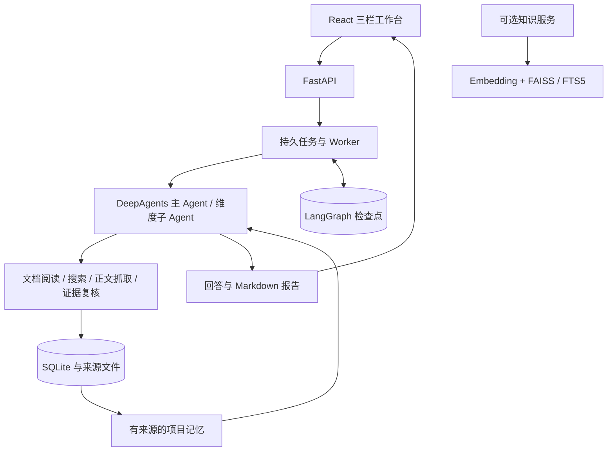

# Research Copilot

面向技术与行业研究的 Agent 工作台。围绕一个主题管理资料和对话，结合文档阅读、联网搜索与多智能体协作，生成带来源的回答和研究报告，并在后续追问中复用项目记忆。

## 功能

- 项目与对话管理：新建项目、独立对话、研究设置、回收站与恢复。
- 渐进式研究：快速解答、主题概览、选择方向后继续深入。
- 资料与引用：上传 PDF / TXT / Markdown，检索网页并保存正文，查看原文定位和来源链接。
- Agent 协作：主 Agent 规划任务，按研究维度委派子 Agent，统一管理执行预算。
- 项目记忆与增量研究：复用带来源的历史结论，对照已有成果整理本轮变化。
- 任务与报告：查看调用过程，取消任务，恢复执行，下载 Markdown 报告和备份本地数据。

## 技术栈

| 模块 | 技术 |
|---|---|
| 前端 | React、TypeScript、Vite、Ant Design、Tailwind CSS |
| 后端 | Python 3.12、FastAPI、Pydantic、WebSocket |
| Agent | DeepAgents、LangChain、LangGraph |
| 数据与任务 | SQLite、持久任务队列、图检查点、项目记忆 |
| 模型与搜索 | OpenAI 兼容 API、Tavily、PyPDF |
| 可选知识服务 | Embedding、FAISS、SQLite FTS5、RRF 混合检索 |

## 架构



左侧管理项目和对话，中间展示研究回答与引用，右侧展示任务状态、额度和调用记录。后端分别保存项目、对话、研究任务、来源版本和证据，支持跨轮研究与重启后恢复。

## 本地部署

准备 Python 3.12、Node.js 22、[uv](https://docs.astral.sh/uv/) 和 pnpm 10。

### 1. 安装

```bash
git clone https://github.com/Kennylin-NotFound/Research-Copilot.git
cd Research-Copilot
uv sync --frozen
pnpm --dir frontend install --frozen-lockfile
```

### 2. 配置

复制 `.env.example` 为 `.env`，填写模型和搜索配置：

| 配置项 | 用途 |
|---|---|
| `OPENAI_BASE_URL` | 模型服务的 OpenAI 兼容地址 |
| `OPENAI_API_KEY` | 模型 API Key |
| `LLM_QWEN_MAX` | 使用的模型名称，需支持工具调用 |
| `TAVILY_API_KEY` | Tavily 搜索 API Key |

初始化应用配置：

```bash
uv run python scripts/local_init.py --import-env .env
```

### 3. 启动

终端一启动后端：

```bash
uv run python scripts/run_backend.py
```

终端二启动前端：

```bash
uv run python scripts/run_frontend.py
```

打开 [http://127.0.0.1:15174](http://127.0.0.1:15174)。API 文档位于 [http://127.0.0.1:18181/docs](http://127.0.0.1:18181/docs)。数据保存在 `data/`，运行配置保存在 `.local/`。

创建研究项目，上传资料或开启联网，发送问题；得到初步回答后，可选择建议方向或直接追问。

<details>
<summary>启用可选知识服务</summary>

在 `.env` 填写 `LIGHT_RAG_EMBED_BASE`、`LIGHT_RAG_EMBED_KEY` 和 `LIGHT_RAG_EMBED_MODEL`，然后执行：

```bash
uv sync --project services/knowledge --frozen
uv run python scripts/knowledge_init.py --import-env .env
uv run --project services/knowledge python scripts/run_knowledge.py
```

知识服务地址为 `http://127.0.0.1:18182`；可通过 `scripts/knowledge_manage.py` 管理文档。

</details>

## 项目来源

基于 [didilili/deepsearch-agents](https://github.com/didilili/deepsearch-agents) 构建，使用 DeepAgents / LangGraph 组织研究任务。
